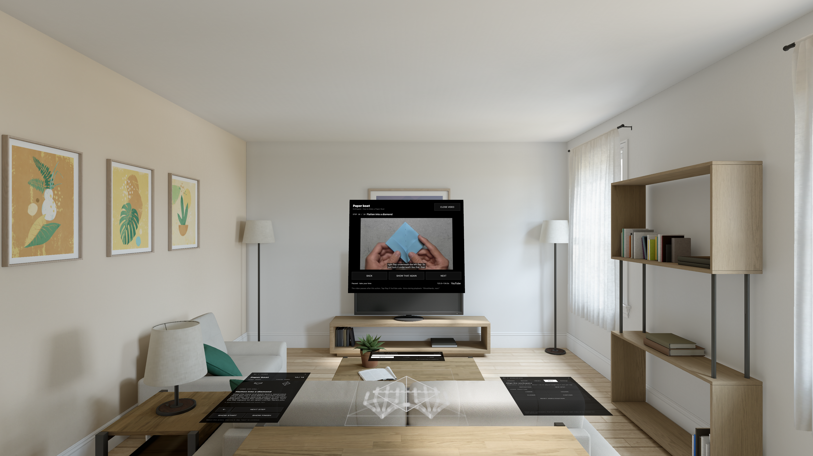
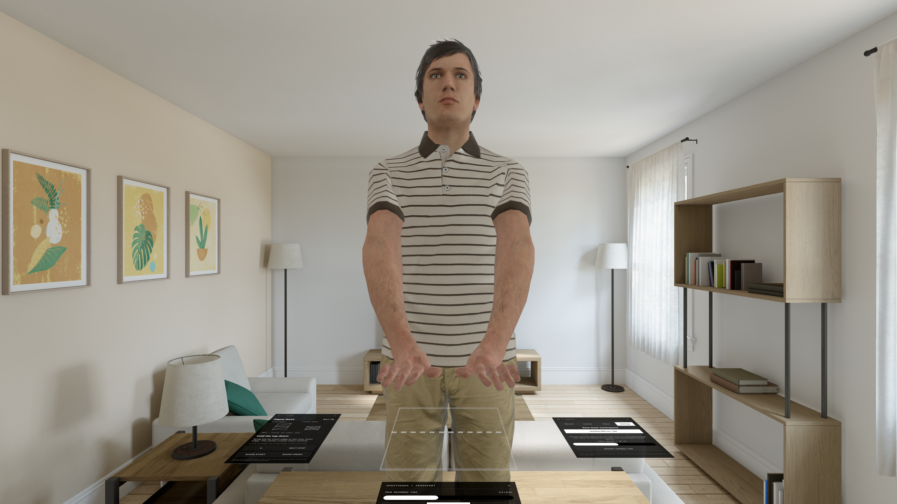

# GhostHands

Learn a hands-on skill through spatial demonstrations on Apple Vision Pro. Built for SASEHacks 2026, GhostHands includes a paper boat lesson, interactive piston-engine, jet-turbine and gearbox labs, and a manually guided cabin-filter replacement rehearsal.



## What it does

- Guides you through clearing a table, then places the workspace from a two-second right-index hold.
- Reveals movement arrows around the paper for horizontal, vertical, and rotational adjustment.
- Demonstrates an 18-step paper boat with animated paper and translucent joint hands.
- Keeps a compact playback panel on the far side of the paper: Play/Pause, speed dropdown, and More menu for replay, loop, start/finish, video and Home.
- Records real hand joints and replays them relative to the paper workspace.
- Seeks the YouTube tutorial to each action, pauses at the segment end, and replays that segment alongside the spatial guide.
- Accepts spoken Next, Back, Slow down, Faster, Show that again, Pause, Play, and Read instructions.
- Bundles 45 natural AI-generated instruction clips for offline playback. Settings → Audio controls automatic reading and repetition after video (off by default). Narration stops when video resumes.
- Anchors YouTube directly above the paper’s far edge, with height/distance adjustments in Place.
- Keeps the right panel at a fixed size with compact tabs, dropdowns and paginated recordings.
- Explores a jet engine with fan, compressor, combustion, turbine, bypass/core flow and exploded inspection; a gearbox adds meshing gears and defect-finding practice.
- Includes a 2018 Toyota Corolla cabin-filter lesson with a 3D housing/filter illustration, manual arrows and a numbered parts tray.
- Teaches an engine’s four-stroke cycle with a native 3D cutaway, moving piston/rod/crank, opening valves and a spark cue. Tap a part or use the parts dropdown to highlight it.
- Authors new lessons with video timestamps, written instructions, fingertip-placed arrows, and local hand takes; imports/exports lesson JSON.
- Offers an optional life-size human for mirrored hand recording/replay (off by default in Settings).

The built-in demonstrations are authored illustrations, not expert recordings or a physical paper simulation. YouTube playback does not generate 3D motion.

## Run

1. Open `GhostHands.xcodeproj` in Xcode with a visionOS SDK (built with Xcode 27; deployment target visionOS 2).
2. Select the GhostHands scheme, your signing team, and an Apple Vision Pro destination.
3. Build and run. Allow hand tracking and world sensing.
4. Enter Workspace, find a large clear spot, and select **I Have a Clear Spot**. Lift your right index, move it to the table center, and hold still for two seconds.
5. Use **Place → Reposition** to expose movement arrows around the paper, then select **Done**.
6. For timed boat/filter lessons, the selected video opens automatically. Tap Play if YouTube requires it. Next/Back select a timed action; Show That Again replays it.
7. Enable **Settings → Voice** and grant microphone/speech permissions. Say “Next,” “Slow down,” or “Show that again.” While video audio is playing, say “GhostHands, next” (the wake phrase helps avoid tutorial speech triggering controls). Auto-read is enabled by default for 3D lessons. Repeat After Video defaults off; enable it in Settings → Audio if wanted. Read Now pauses the video first.
8. Choose **Lessons → Cabin air filter** for the repair rehearsal. Use **Place → Arrow Start/End** to anchor each action manually. Tray buttons mark parts stored/returned; they do not detect objects.
9. **Lessons → New Lesson / Edit a Copy** opens the editor. Load a YouTube URL, scrub it, mark Start/End, write each action, preview, and save. Record and attach a take for custom hand motion. JSON export includes cues and timings; recordings remain local.
10. Choose **Lessons → Inside a car engine** for the engine lesson. Use Next to study each stroke, or Replay/Loop in the playback More menu. Its reference video is optional and plays independently.
11. For human replay, turn on **Settings → Scene → Human Replay**, record both hands, then replay the take.

The Place controls include rotation, movement, and 2 mm height adjustment. Real hand recording requires Vision Pro; the simulator can show the authored animations.

## Code map

| File | Responsibility |
| --- | --- |
| `StudioModel.swift` | Session state, placement, playback, recording, saving |
| `Placement.swift` | Stable fingertip calibration |
| `HandCapture.swift` | ARKit tracking and fresh joint snapshots |
| `SpatialStudio.swift` | RealityKit scene and tabletop panels |
| `PaperLesson.swift` | Boat instructions and generated hand demonstrations |
| `PaperMotion.swift` | Authored folding geometry and hand contact paths |
| `EngineCycle.swift` | Crank/rod/piston geometry and teaching stroke states |
| `LabContent.swift`, `LabVisual.swift` | Turbofan/gearbox lessons and interactive procedural assemblies |
| `NarrationPolicy.swift` | Narration preferences and exact-text offline clip lookup |
| `MechanicalVisual.swift` | Interactive engine cutaway and filter housing illustration |
| `HologramHand.swift` | Translucent joint rendering |
| `StudioUI.swift` | SwiftUI controls |
| `Lessons.swift` | Reusable lesson schema, boat/repair catalog and storage |
| `VideoSession.swift`, `PlayerHTML.swift`, `VideoReference.swift` | Serialised player commands, official YouTube bridge and segment playback |
| `VoiceCoach.swift` | On-device speech commands and narration/audio coordination |
| `LessonAuthorView.swift` | Timestamp editor, spatial cues, local takes and JSON import/export |
| `AvatarRig.swift` | Mirrored hand mapping and inferred arm movement |
| `HumanReplay.swift` | Loads and animates the optional human |

Source files are in `GhostHands/`.

## Validation

```sh
swift test --scratch-path /tmp/GhostHandsTests --disable-sandbox
node Scripts/player-controller-tests.cjs
```

Build 10: 57 core tests and 8 player-controller scenarios passed. All 45 narration files decoded successfully. Device and simulator builds, live docked-video playback, and physical installation are recorded in `VALIDATION.txt`. Worn-headset menu reach, video comfort, targeting and audio quality still require user testing.

## Data and assets

Recordings and custom lessons stay on the device unless explicitly exported. Voice uses on-device English speech recognition when available; unavailable recognition leaves the buttons usable. No microphone audio is saved by GhostHands. YouTube playback uses the network and its official player. This repository excludes recordings, provisioning profiles, signed builds, and device installation logs. Included Apple hand reference assets retain their license in `GhostHands/HandResources/AppleGlove-LICENSE.txt`; the current renderer uses procedural joint geometry.

## Engine lesson

The engine is an original procedural teaching model of one spark-ignition cylinder, with simplified valve timing and combustion cues. It is not a scanned engine or a vehicle-specific repair procedure. The lesson follows [Briggs & Stratton’s four-stroke explanation](https://www.briggsandstratton.com/en-us/support/videos/4-stroke-theory); its [reference video](https://www.youtube.com/watch?v=kMCfZL9HgSk) is optional and has no claimed timestamp synchronization. Piston, connecting rod, crankshaft, inlet/exhaust valves and spark plug can be selected by hand targeting or the parts dropdown.

## Human replay

The bundled human is Microsoft Rocketbox’s Male_Adult_01, converted to USDZ and normalized to 1.75 m. Its MIT license and provenance are in `GhostHands/AvatarResources/`. Recorded hand positions are rotated 180° for face-to-face mirrored replay. Arm bends and wrist orientation are inferred; this is not full-body motion capture. Both hands must be tracked; gaps hide the avatar. It is a textured game character, not a photoreal scan. Adjust Table Height in Settings to align the feet with the room.

The boat source is [How to Make a Paper Boat by EzOrigami](https://www.youtube.com/watch?v=vNba3jbBSOw). The repair source is [Filterheads’ 2018 Corolla cabin filter replacement](https://www.youtube.com/watch?v=LFA9g7GdXbQ), specifically showing AQ1102C UP markings. Confirm the exact vehicle/filter match before working on a car. The first repair mode is a tabletop rehearsal with manually placed arrows, not vehicle scanning or automatic part recognition.

Timestamps were manually reviewed. Illustrated folds are stretched across each video segment; they are not frame-exact captured movements. New YouTube links require authored steps and timings; arbitrary videos are not automatically converted to 3D. Offline, close the video and use the authored guide.



## Jet, gearbox and narration

The turbofan lesson uses an original procedural cutaway with selectable modules, rotating compressor/turbine stages, core and bypass flow, and a miniature aircraft silhouette. The [NASA turbofan explanation](https://www.grc.nasa.gov/www/k-12/airplane/Animation/turbtyp/etfh.html) informs the lesson. The gearbox illustrates a 12:24 tooth ratio. Exploded views and deliberately shortened components support visual inspection practice; these are teaching models, not engineering simulations or maintenance instructions.

`NarrationResources/manifest.json` documents 45 AI-generated clips produced from the original built-in instructions using OpenAI gpt-4o-mini-tts and the Cedar voice. The app plays the bundled MP3 files offline; it contains no API key and makes no speech-generation requests. Edited/custom instructions use the best installed English device voice. Generation reference: [OpenAI text-to-speech guide](https://developers.openai.com/api/docs/guides/text-to-speech).
