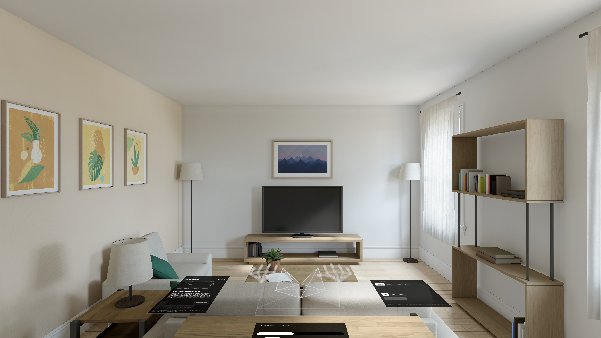

# GhostHands

Learn a hands-on skill through spatial demonstrations on Apple Vision Pro. Built for SASEHacks 2026, GhostHands focuses on folding a paper boat from a full US Letter sheet.



## What it does

- Places a paper guide and flat controls on a manually calibrated tabletop.
- Demonstrates an 18-step paper boat with animated paper and translucent joint hands.
- Supports autoplay per step, speed controls, start/finish inspection, and optional looping.
- Records real hand joints and replays them relative to the paper workspace.
- Provides a separate YouTube reference player.

The built-in demonstrations are authored illustrations, not expert recordings or a physical paper simulation. YouTube playback does not generate 3D motion.

## Run

1. Open `GhostHands.xcodeproj` in Xcode with a visionOS SDK (built with Xcode 27; deployment target visionOS 2).
2. Select the GhostHands scheme, your signing team, and an Apple Vision Pro destination.
3. Build and run. Allow hand tracking and world sensing.
4. Enter Workspace. Rest your right index fingertip on the paper center and hold still. Open your left thumb/index, then pinch and hold briefly to lock the workspace.

The Place controls include rotation, movement, and 2 mm height adjustment. Real hand recording requires Vision Pro; the simulator can show the authored animations.

## Code map

| File | Responsibility |
| --- | --- |
| `StudioModel.swift` | Session state, placement, playback, recording, saving |
| `Placement.swift` | Stable fingertip calibration and pinch confirmation |
| `HandCapture.swift` | ARKit tracking and fresh joint snapshots |
| `SpatialStudio.swift` | RealityKit scene and tabletop panels |
| `PaperLesson.swift` | Boat instructions and generated hand demonstrations |
| `PaperMotion.swift` | Authored folding geometry and hand contact paths |
| `HologramHand.swift` | Translucent joint rendering |
| `StudioUI.swift` | SwiftUI controls |

Source files are in `GhostHands/`.

## Validation

```sh
swift test --scratch-path /tmp/GhostHandsTests --disable-sandbox
```

Build 5: 30 tests passed, signed device and simulator builds succeeded, and the simulator view was inspected. The build 5 physical installation attempt was interrupted by a device disconnect. Direct-touch alignment and complete beginner tutorial usability still require worn-headset validation.

## Data and assets

Recordings stay on the device. This repository excludes recordings, provisioning profiles, signed builds, and device installation logs. Included Apple hand reference assets retain their license in `GhostHands/HandResources/AppleGlove-LICENSE.txt`; the current renderer uses procedural joint geometry.

Automatic boat-video selection and an optional full-body teaching avatar are planned, not implemented in this snapshot.
